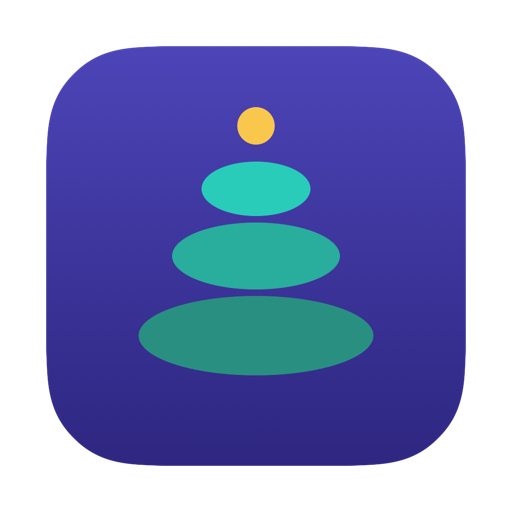
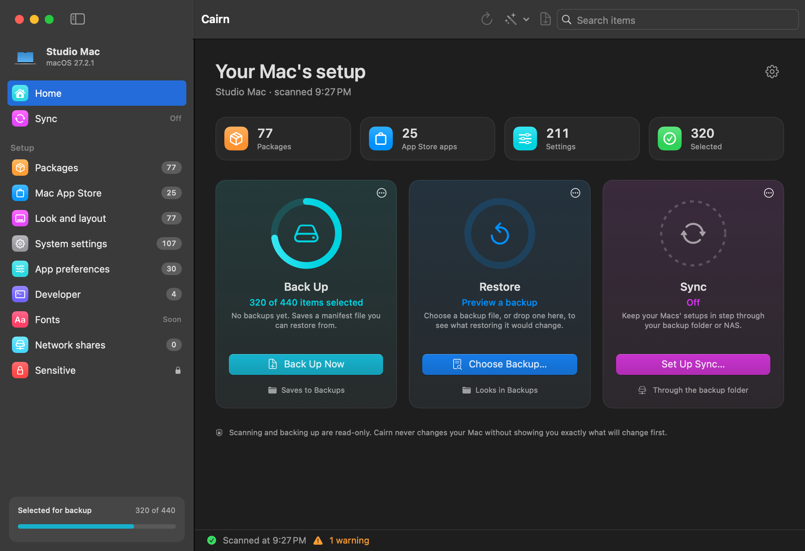

<div align="center">



# Cairn

**Set up a new Mac in minutes.**

Cairn backs up, restores, and syncs your Mac's *setup*: apps, Homebrew packages, Dock, system settings,
app preferences, displays, and network shares. It never touches your files.


<br>



</div>

---

## Why Cairn?

Think **Homebrew Bundle + macprefs + a dotfiles playbook**, wrapped in a native SwiftUI app with a
checklist, snapshots, and NAS storage. Cairn records your setup as a readable YAML manifest of
*intent* ("VLC is installed", "the Dock auto-hides"), not raw OS files. The same manifest can
set up a Windows or Linux PC.

> [!NOTE]
> Cairn is not Time Machine. It never backs up Documents, Photos, or other personal files. It
> stores the setup that makes a machine feel like *yours*.

## ✨ Features

### Back up

| Category | What's saved |
|---|---|
| 📦 **Homebrew** | Formulae, casks, and taps you installed on purpose |
| 🛍️ **Mac App Store** | Your purchased apps, saved to install after you sign in |
| 🧭 **Dock and layout** | Dock order, spacers, and Dock, Finder, menu bar, and Mission Control settings |
| ⚙️ **System settings** | Keyboard, trackpad, sound, energy, and more |
| 🧩 **App preferences** | Allowlisted app settings, with caches, window state, IDs, and anything that looks like a token filtered out |
| 🖥️ **Displays** | Monitor arrangement, main display, resolution, refresh rate, and mirroring, matched per monitor |
| 🌐 **Network shares** | SMB, AFP, NFS, and WebDAV shares plus Finder's Connect to Server favorites (usernames only, never passwords) |
| 🔐 **Secrets** | Wi-Fi passwords, SSH keys, credential files (GitHub CLI, npm, AWS, Docker, and more), and share passwords you choose, encrypted in your vault. VPN configurations are listed for the post-restore checklist |

### Store

- **Snapshots with history.** Each backup links to the one before it, so you can diff any two and roll back.
  Cairn writes a new snapshot only when something changed.
- **Local folder or NAS.** Point Cairn at a mounted SMB share. If the NAS is offline, snapshots wait on
  your Mac and copy over when it's back.
- **Automatic backups.** A background agent backs up on a schedule and soon after your settings change.
- **Clean diffs.** Manifests are deterministic YAML with sorted keys and stable ordering.

### Restore

- **Dry run first, always.** Restore shows exactly what would change. Nothing is written until you
  press Apply (or pass `--apply`).
- **In order, from the app or the CLI.** Command Line Tools, Homebrew packages (taps, formulae, casks),
  App Store apps, secrets, settings, then the Dock and wallpaper. Press Restore in the preview, or run
  `cairn restore --from <backup> --apply`. Each item is checked afterwards against a fresh scan.
- **Settings and Dock.** Settings are written back and the affected apps restarted.
  Dock icons for apps that aren't installed yet are added back automatically once the app appears.
- **Displays.** Puts your monitors back in the same arrangement, even on a different desk.
- **Post-restore checklist.** Anything macOS insists you approve by hand (privacy permissions, iCloud,
  display rotation, share passwords) is listed for you instead of being forced.

### Use it your way

- **Native Mac app.** Home dashboard, a checklist for every category with search and item counts,
  presets (Minimal, Developer, Everything), drag and drop, and a Settings window.
- **Full CLI.** Everything the app does, `cairn` does too, so it's scriptable.
- **Safe by design.** Scanning is read-only and runs through a command allowlist. Secrets are never logged.

## 🗺️ Roadmap

| # | Milestone | Status |
|---|---|---|
| 1 | Manifest format, `cairn scan`, `cairn diff` | ✅ Done |
| 2 | SwiftUI checklist app, export manifests | ✅ Done |
| 3 | Snapshots, NAS storage, automatic backups, network shares | ✅ Done |
| 4 | 🔐 Encrypted vault: Wi-Fi networks, SSH keys, API tokens, share passwords, VPN list | ✅ Done |
| 5 | Full restore: Xcode tools → Homebrew → packages → App Store → settings → layout | 🚧 In progress (all steps built, Restore button in the app; VM testing) |
| 6 | 🔄 Sync between your Macs, auto-discovered on your network | 🚧 In progress (NAS or device-to-device, pairing with codes; VM testing) |
| 7 | 🪟 **Windows** (winget) and 🐧 **Linux** (apt, dnf, Flatpak) | 🚧 In progress (setup kits from any backup) |

### Windows and Linux

Cairn's manifest describes what you want, not how one OS stores it. **File → Export for Windows…**
(or Linux, or `cairn export windows|linux`) turns a backup into a setup kit for a PC:

- **Windows:** `setup.ps1` installs packages with `winget` and sets a few matching settings (dark
  mode, file extensions, hidden files). `winget.json` works with `winget import` too.
- **Linux:** `setup.sh` installs tools with `apt` or `dnf`, apps from Flathub, and a few GNOME
  settings.
- **`CHECKLIST.md`:** what to do by hand: packages with no known equivalent, App Store apps, and
  network shares (as `\\server\share` on Windows).

Both scripts only list what they would do until you run them with `-Apply` / `--apply`. Homebrew
names are matched through a built-in catalog, checked against winget-pkgs, Flathub, Ubuntu and Fedora
by `scripts/check-catalog.py`; a package's own `resolvers` in the manifest win:

```yaml
packages:
  - id: vlc
    kind: cask
    resolvers: { brew: vlc, winget: VideoLAN.VLC, flatpak: org.videolan.VLC }
    include: true
```

Mac-only packages and settings are kept in the backup and listed in the checklist, never lost.
Secrets are never exported: they stay encrypted in your backup.

### Encryption (milestone 4)

Sensitive items are encrypted per item with AES-256-GCM, under a vault key wrapped by your password
(PBKDF2-SHA256, 600,000+ iterations) and a one-time recovery key. Everything else stays plain YAML so
you can read and diff it.

---

## 🚀 Getting started

**You'll need:** macOS 14 or later on Apple Silicon, and Swift 5.9 or later (the Command Line Tools are
enough; you don't need Xcode). Optional, for scanning: Homebrew and `mas` (`brew install mas`).

Build `Cairn.app` and put it in `~/Applications`:

```bash
scripts/build-app.sh --install
```

Without `--install` it only builds `dist/Cairn.app`. The CLI is bundled inside at
`Cairn.app/Contents/MacOS/cairn`.

Build and run the tests:

```bash
swift build
swift test
```

<details>
<summary><b>CLI reference</b></summary>

```bash
# Scan to stdout or a file; limit scanners; add a preferences domain
cairn scan
cairn scan -o ~/Desktop/mac.yaml
cairn scan --only brew,mas
cairn scan --only defaults --domain com.example.SomeApp

# Compare two manifests (exit 0 = same, 1 = different)
cairn diff old.yaml new.yaml

# Save a snapshot (only if something changed), to the app's folder or a NAS
cairn backup
cairn backup --to /Volumes/NAS/Cairn

# Snapshot history and what changed
cairn snapshots
cairn snapshots --diff
cairn snapshots --diff 2026-11-20 2026-11-21-101500

# Restore or roll back (dry run until --apply)
cairn restore --from 2026-11-20-090000
cairn restore --from backup.yaml --apply
# Saved Wi-Fi passwords are decrypted only with --apply, after the vault password
# (prompted, or --password-stdin); they never appear in output or a command line

# Dock icons waiting for their apps; display arrangement
cairn dock --resume
cairn displays --from backup.yaml --apply

# Automatic backups
cairn auto-backup on --every 60
cairn auto-backup status

# Encryption vault for Sensitive items (prompts without echo)
cairn vault init            # shows the one-time recovery key
cairn vault check
cairn vault change-password --recovery
cairn vault secrets                      # Wi-Fi, SSH keys, credential files, share passwords, VPNs
cairn vault secrets --name "Home"       # save one (macOS asks to approve Keychain reads)
cairn vault remember                     # keep the vault key in this Mac's Keychain (forget undoes)

cairn sync mode direct                   # or folder (through the backup folder / NAS, the default)
cairn sync folder --connect smb://nas.local/Backups Cairn  # sync through a folder on a NAS share (or any path)
cairn sync on                            # preset: portable (default), everything, or nothing
cairn sync id                            # this Mac's device ID
cairn sync pair                          # Macs found on the network; then --to <name> (both show a code)
cairn sync pair <ID>                     # or pair by typing the other Mac's ID (on both Macs)
cairn sync requests                      # Macs in the shared folder asking to sync; accept / ignore <ID>
cairn sync                               # what a sync would do; changes nothing
cairn sync now                           # publish this Mac's changes, list ones from other Macs
cairn sync now --apply                   # also bring those in (shown first, then checked)
cairn sync scope layout:dock synced      # a category or one item: synced, this-mac, ignored, default
cairn sync resolve <id> --theirs --apply # settle a conflict (or --mine, --skip)
cairn sync devices
cairn export windows --out ~/Desktop    # or linux: a setup kit for a PC (from the newest snapshot)
```

While developing, use `swift run cairn …` and `swift run CairnApp`.

</details>

<details>
<summary><b>What gets scanned</b></summary>

| Scanner    | Reads |
|------------|-------|
| `brew`     | `brew leaves --installed-on-request`, `brew list --cask`, `brew tap` |
| `mas`      | `mas list` |
| `dock`     | `defaults export com.apple.dock -` (tile order and Dock settings) |
| `defaults` | `defaults export <domain> -` for an allowlist of Apple and common third-party apps |
| `displays` | CoreGraphics display list and modes; serial numbers are stored only as a short hash |
| `shares`   | `mount` (network filesystems) and Finder's Connect to Server favorites |
| `wifi`     | `networksetup -listpreferredwirelessnetworks` on the detected Wi-Fi port (names only) |

Every command goes through a read-only allowlist (`CommandPolicy.readOnly`), so a scanner can't run
`defaults write`, `brew install`, and so on.

</details>

<details>
<summary><b>How snapshots are stored</b></summary>

Snapshots live in the backup folder as `snapshots/<device>/<yyyy-MM-dd-HHmmss>/`, each holding a
`manifest.yaml` and a `snapshot.yaml`. The `snapshot.yaml` records the parent snapshot, what triggered
the backup, a `+added -removed ~changed` summary, and the items you unchecked, so later backups keep
your selection. If the backup folder is an unmounted NAS share, snapshots wait in
`~/Library/Application Support/Cairn/Queue` and are copied on the next run that can reach it. Cairn
never creates a missing folder under `/Volumes`.

</details>

<details>
<summary><b>Developer notes</b></summary>

- One Swift package: `CairnCore` (model, scanners, restorers, storage), the `cairn` CLI, and `CairnApp` (SwiftUI).
- Only two dependencies: [Yams](https://github.com/jpsim/Yams) and [swift-argument-parser](https://github.com/apple/swift-argument-parser).
- Unit tests use recorded command output, never live `brew` or `defaults`.
- Restore is tested only in throwaway macOS VMs (`scripts/vm.sh`, using [Tart](https://tart.run)), never on a real account.
- Debug builds can screenshot their own window: `CAIRN_SNAPSHOT=/tmp/cairn.png swift run CairnApp`.
- Design notes live in [CLAUDE.md](CLAUDE.md).

</details>

<div align="center">
<sub>A cairn is a stack of stones that marks the trail, so whoever comes next finds the way.</sub>
</div>
